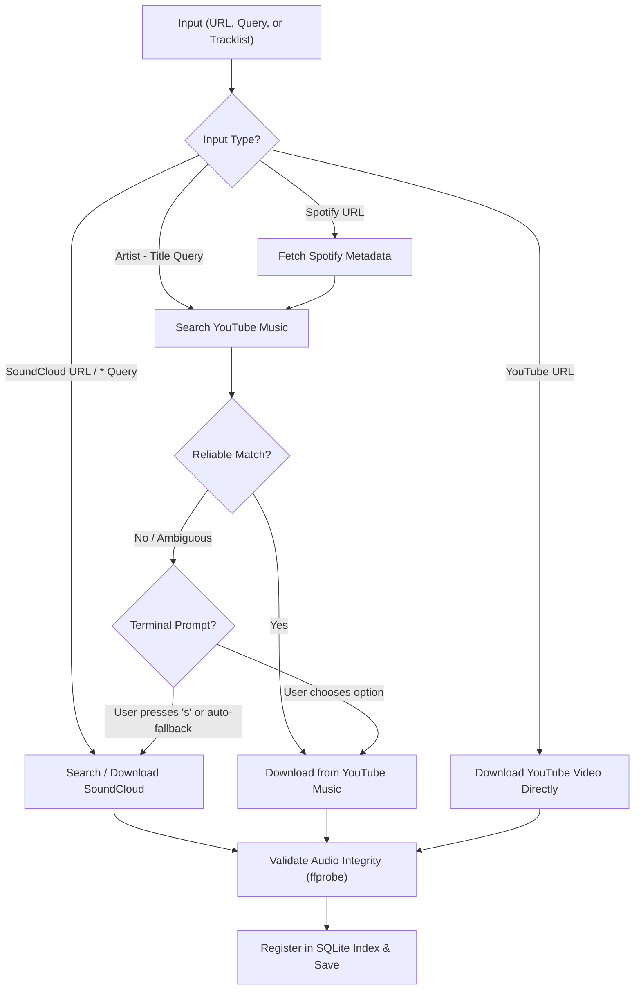

# ytscloud

<p align="center">
  <strong>music-ytscloud-downloader: Tracklists in. Clean, tagged audio files out.</strong>
</p>

<p align="center">
  <a href="#quick-start"></a>
  <a href="LICENSE"></a>
  <a href="#automation"></a>
  <a href="#development"></a>
</p>

**ytscloud** (published as `music-ytscloud-downloader`) is a local, lightweight command-line tool built for personal music workflows and DJ tracklist automation. Feed it a tracklist text file, search queries, or direct links from **YouTube**, **Spotify**, or **SoundCloud**, and get organized, validated **MP3** or **WAV** files saved in a single destination folder.

---

## Table of Contents

- [Key Features](#key-features)
- [How It Works](#how-it-works)
- [Prerequisites](#prerequisites)
- [Quick Start](#quick-start)
- [Usage Guide](#usage-guide)
  - [1. Single Songs & Text Queries](#1-single-songs--text-queries)
  - [2. Tracklist Files](#2-tracklist-files)
  - [3. Direct URLs](#3-direct-urls)
  - [4. Output Folder & Format Selection](#4-output-folder--format-selection)
- [Interactive Version Selection](#interactive-version-selection)
- [Automation & DJ Integrations (JSON Lines)](#automation--dj-integrations-json-lines)
- [Folder Structure & Duplicate Prevention](#folder-structure--duplicate-prevention)
- [Optional Spotify Credentials](#optional-spotify-credentials)
- [Command Reference](#command-reference)
- [Troubleshooting](#troubleshooting)
- [Development & Testing](#development--testing)
- [Disclaimer](#disclaimer)

---

## Key Features

- **Flexible Input**: Accepts `Artist - Title`, prefixed SoundCloud queries `* Artist - Title`, numbered tracklists, timestamps (e.g. DJ cue sheets), and direct web URLs.
- **Smart Audio Matching**: Matches Spotify tracks via YouTube Music audio, with strict validation against duration mismatches, unofficial covers, live bootlegs, or incorrect edits.
- **Graceful Fallback**: Automatically or interactively falls back from YouTube Music to SoundCloud when a reliable match is not found.
- **Interactive Disambiguation**: In terminal mode, choose among ranked matches, jump to SoundCloud with `s`, or skip with `0`.
- **Safe & Non-Destructive**: Embedded SQLite index (`.ytscloud.sqlite3`) remembers downloaded tracks, checksums, and source URLs. Never overwrites files and instantly skips repeats.
- **DJ & Scripting Friendly**: Emits clean [JSON Lines](#automation--dj-integrations-json-lines) via `--json` for headless automation, scripts, and DJ library tools (such as Piloto DJ).
- **Post-Download Audio Validation**: Every downloaded file is probed with `ffprobe` to guarantee zero corruption before moving to the final library.

---

## How It Works

| Input Type | Discovery Method | Audio Source |
|---|---|---|
| `Artist - Title` | Direct query on YouTube Music | YouTube Music (SoundCloud fallback) |
| `* Artist - Title` | Direct search on SoundCloud | SoundCloud |
| **YouTube Video URL** | Direct extraction of video ID | YouTube |
| **Spotify Track or Playlist URL** | Spotify metadata lookup &rarr; YouTube Music match | YouTube Music |
| **SoundCloud Track or Set URL** | SoundCloud API resolution | SoundCloud |



> [!IMPORTANT]
> Spotify links are used solely for metadata resolution; audio is never extracted directly from Spotify. Converting compressed web audio to WAV does not restore lost acoustic fidelity. Always ensure you have rights to download content for personal use.

---

## Prerequisites

Before using ytscloud, make sure you have the following installed on your system:

1. **Python**: `3.11` to `3.15`
2. **FFmpeg & ffprobe**: Required for audio transcoding and validation.
3. **Deno (2.3+) or Node.js (22+)**: Required by `yt-dlp` to execute YouTube signature deciphers (EJS).

### Installation of prerequisites

#### macOS (Homebrew)
```bash
brew install ffmpeg deno python@3.12
```

#### Linux (Debian / Ubuntu)
```bash
sudo apt update
sudo apt install -y ffmpeg python3 python3-venv python3-pip nodejs
```

---

## Quick Start

1. **Clone the repository:**
   ```bash
   git clone https://github.com/nachopalomares/music-ytscloud-downloader.git
   cd music-ytscloud-downloader
   ```

2. **Create and activate a virtual environment:**
   ```bash
   python3 -m venv .venv
   source .venv/bin/activate  # On Windows: .venv\Scripts\activate
   ```

3. **Install the package in editable mode:**
   ```bash
   pip install -e .
   ```

4. **Run a test download using the included example tracklist:**
   ```bash
   ytscloud --file examples/set.txt --folder "downloads/demo-set"
   ```

*(Alternatively, run `.venv/bin/ytscloud` directly without activating the virtual environment).*

---

## Usage Guide

### 1. Single Songs & Text Queries

Search YouTube Music directly:
```bash
ytscloud 'Metrika, L0rna - Lip Combo' --folder "My Set"
```

Prefix with `*` to search SoundCloud directly (useful for edits, bootlegs, and DJ club mixes):
```bash
ytscloud '* Dj Rankng - Puro Reggaetón (Dj Rankng Edit)' --folder "My Set"
```

> [!TIP]
> Always quote search queries containing special characters, asterisks (`*`), spaces, or parentheses to prevent your shell from expanding them.

### 2. Tracklist Files

Create a plain UTF-8 text file (e.g. `set.txt`) with one entry per line. Leading track numbers or cue timestamps are automatically stripped:

```text
01. Metrika, L0rna - Lip Combo
02. 8belial - Mr. Fino
03.* Bad Gyal, Ivy Queen - PERDIÓ [KAYVVY EDIT]
04. https://open.spotify.com/track/4cOdK2wGLETKBW3PvgPWqT
```

Run:
```bash
ytscloud --file set.txt --folder "My Set"
```

You can also pipe tracklists via standard input using `--file -`:
```bash
cat set.txt | ytscloud --file - --folder "My Set"
```

### 3. Direct URLs

ytscloud natively supports direct URLs:

```bash
# YouTube video or Short
ytscloud 'https://www.youtube.com/watch?v=dQw4w9WgXcQ' --folder "My Set"
ytscloud 'https://youtu.be/dQw4w9WgXcQ' --folder "My Set"

# Spotify track or public playlist
ytscloud 'https://open.spotify.com/track/4cOdK2wGLETKBW3PvgPWqT' --folder "My Set"
ytscloud 'https://open.spotify.com/playlist/37i9dQZF1DXcBWIGoYBM5M' --folder "My Set"

# SoundCloud track or public set/playlist
ytscloud 'https://soundcloud.com/artist/track-name' --folder "My Set"
ytscloud 'https://soundcloud.com/artist/sets/my-dj-set' --folder "My Set"
```

### 4. Output Folder & Format Selection

- Default format is **MP3**. Pass `--format wav` for uncompressed WAV.
- Default output folder is `downloads/`. Pass `--folder` or `--output` to specify a custom directory:

```bash
ytscloud --file set.txt --folder ~/Music/DJSets/Set1 --format wav
```

---

## Interactive Version Selection

When running in an interactive terminal, if YouTube Music matches are ambiguous or don't pass strict verification, ytscloud displays a clean selection menu with up to 7 ranked choices:

```text
  Opciones encontradas:
    1. Artist - Track Name (Official Audio) [03:24]
    2. Artist - Track Name (Club Edit) [04:12]
    3. Artist - Track Name (Remix) [03:45]
  Elige 1-3 (Enter = 1, 0 = saltar, s = buscar en SoundCloud):
```

| Key | Action |
|:---:|---|
| **`1` – `7`** | Download that specific candidate |
| **`Enter`** | Accept the top-ranked match |
| **`0`** | Skip this song and proceed to the next track |
| **`s`** | Discard YouTube results and search SoundCloud for this track |

To run completely headless without prompts, use `--yes` (or `-y`), `--json`, or piped input.

---

## Automation & DJ Integrations (JSON Lines)

For integration with scripts, automated schedulers, or DJ software (such as **Piloto DJ**), use `--json`:

```bash
ytscloud --file set.txt --folder "My Set" --json > results.jsonl
```

### Stream Event Output
Each processed item prints one JSON object to `stdout`:

```json
{"status": "downloaded", "requested_input": "Metrika, L0rna - Lip Combo", "track_url": "https://music.youtube.com/watch?v=...", "source_url": "https://www.youtube.com/watch?v=...", "path": "/path/to/My Set/Metrika, L0rna - Lip Combo.mp3"}
{"status": "skipped", "requested_input": "8belial - Mr. Fino", "source_url": "https://www.youtube.com/watch?v=...", "path": "/path/to/My Set/8belial - Mr. Fino.mp3"}
{"status": "error", "requested_input": "Invalid Track", "error": "No reliable audio source found"}
```

A summary object is always emitted at the end:

```json
{"status": "summary", "downloaded": 18, "skipped": 2, "errors": 1, "failed_tracks": ["Invalid Track"]}
```

### CLI Exit Codes

| Exit Code | Meaning |
|:---:|---|
| `0` | All requested items succeeded (or were intentionally skipped) |
| `1` | One or more items failed to download or resolve |
| `2` | Configuration, CLI argument, or missing dependency error |
| `130` | Execution interrupted by user (`SIGINT` / `Ctrl+C`) |

---

## Folder Structure & Duplicate Prevention

ytscloud creates a clean, flat folder structure containing your audio files and a lightweight SQLite database:

```text
My Set/
├── Artist - Track 01.mp3
├── Artist - Track 02.mp3
├── Artist - Track 02 [youtube-videoId].mp3   # Collision avoided automatically
└── .ytscloud.sqlite3                        # Local database index
```

### SQLite Index (`.ytscloud.sqlite3`)
- Records source platform, IDs, resolved URLs, local file paths, and SHA-256 hashes.
- Detects previously completed downloads and skips them instantly.
- Detects renamed or modified files without clobbering or re-downloading blindly.
- Preserves legacy spotDL structures and `.spotycloud.sqlite3` databases seamlessly.

---

## Optional Spotify Credentials

By default, ytscloud uses anonymous metadata resolution for Spotify links. To avoid rate limits or use official Spotify Developer APIs, export your credentials:

```bash
export SPOTIFY_CLIENT_ID="your_spotify_client_id"
export SPOTIFY_CLIENT_SECRET="your_spotify_client_secret"
```

---

## Command Reference

```text
ytscloud [-h] [--file FILE] [--folder FOLDER] [--output OUTPUT]
         [--format {mp3,wav}] [--yes] [--json] [inputs ...]
```

| Argument | Type | Description |
|---|---|---|
| `inputs` | Positional | One or more songs or URLs to process. |
| `--file PATH`, `-f` | Flag | Path to a tracklist file (`-` reads standard input). |
| `--folder PATH`, `--output PATH` | Flag | Output directory for audio and database (default: `downloads/`). |
| `--format mp3\|wav` | Flag | Target audio format (default: `mp3`). |
| `--yes`, `-y` | Flag | Non-interactive mode; auto-accept top verified matches. |
| `--json` | Flag | Output structured JSON Lines and silence interactive prompts. |
| `--help`, `-h` | Flag | Display CLI help message. |

*(Note: `spotycloud` remains supported as a CLI alias).*

---

## Troubleshooting

| Symptom | Cause & Solution |
|---|---|
| `This video is DRM protected` | Content is encrypted. ytscloud respects access controls; select another authorized upload. |
| `ffprobe failed` / `corrupt audio` | The source stream was incomplete or damaged during download. ytscloud discards it and retries safely. |
| `JavaScript runtime required` | Install Deno (`brew install deno`) or Node.js (`sudo apt install nodejs`) and ensure it is on your `$PATH`. |
| `ffmpeg or ffprobe missing` | Ensure FFmpeg is installed and accessible from your terminal. |
| Menu does not appear | Prompts are automatically suppressed when using `--yes`, `--json`, or non-interactive pipes. Run directly in a TTY. |

---

## Development & Testing

The project includes a full unit and integration test suite covering input parsing, fuzzy metadata matching, legacy folder migrations, collision avoidance, and audio integrity checks:

```bash
# Run all unit tests
python -m unittest discover -s tests -v

# Verify packaging integrity
python -m pip check
```

Remote API calls are fully mocked, and synthetic audio samples are generated locally via FFmpeg during testing.

---

## Disclaimer

ytscloud is intended strictly for personal archiving, backup, and authorized DJ workflows. Please respect artist copyrights, platform terms of service, and applicable laws in your jurisdiction. ytscloud does not bypass DRM, decryption schemes, or private access controls.

---

## License

This project is licensed under the [MIT License](LICENSE). Third-party dependencies retain their respective licenses.
